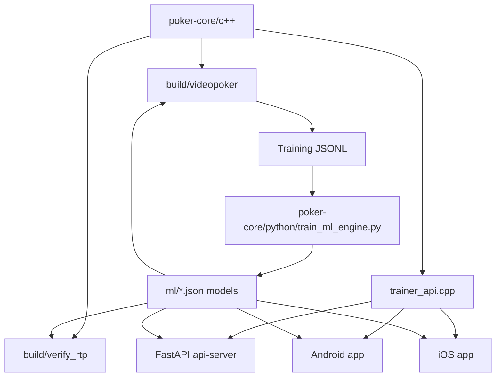

# Equilibrium

Equilibrium is a multi-platform video poker trainer and analysis suite built around a shared C++ core. It currently supports two Jacks or Better paytables, exposes solver, rule, and ML autohold engines, ships mobile trainer apps for Android and iOS, and includes CLI and FastAPI interfaces for simulation and integration.

## Current Features

- Shared C++17 poker engine used by CLI tools, Android, iOS, and the API
- Two supported game variants:
  - `jacks_or_better_9_6`
  - `jacks_or_better_8_5`
- Three autohold engines:
  - `solver`: exhaustive EV search over all 32 hold masks
  - `rule`: handcrafted strategy table
  - `ml`: local JSON neural-network inference
- RTP verification tool for comparing engines against optimal play
- Training-data export and Python ML trainer
- Android app with Compose + JNI bridge
- iOS app with SwiftUI + Objective-C++ bridge
- FastAPI server backed by the same native trainer API

## Supported Variants

| Variant ID | Display Name | Optimal RTP |
| --- | --- | --- |
| `jacks_or_better_9_6` | Jacks or Better 9/6 | `99.5439%` |
| `jacks_or_better_8_5` | Jacks or Better 8/5 | `97.2985%` |

The current paytable difference is the standard 9/6 vs 8/5 change:

- `9/6`: Full House `9x`, Flush `6x`
- `8/5`: Full House `8x`, Flush `5x`

## Architecture



## Repository Layout

- `poker-core/c++`: core engine, solver, rule engine, ML inference, trainer API
- `poker-core/python`: ML training script
- `ml`: trained JSON models such as `modeljob96.json` and `modeljob85.json`
- `api-server`: FastAPI app and Dockerfile
- `android-app`: Android Studio project
- `ios-app`: Xcode project
- `csharp-app`: Windows Forms client for the API
- `resources/cards`: shared card image assets

## Build

Build the CLI binaries from the repo root:

```bash
bash ./build.sh
```

This produces:

- `build/videopoker`
- `build/verify_rtp`

## CLI

### `videopoker`

Usage:

```bash
./build/videopoker \
  [--engine solver|rule|ml] \
  [--variant jacks_or_better_9_6|jacks_or_better_8_5] \
  [--ml-model /abs/path/to/model.json] \
  [--print-strategy] \
  [--dump-training training.jsonl] \
  coins bet iterations
```

Notes:

- `solver` is the default engine
- `jacks_or_better_9_6` is the default variant
- `--ml-model` is required when `--engine ml`
- `--dump-training` writes solver-generated JSONL rows for ML training

Examples:

```bash
./build/videopoker --variant jacks_or_better_9_6 100 5 10
./build/videopoker --engine rule --variant jacks_or_better_8_5 100 5 10
./build/videopoker --engine ml --variant jacks_or_better_9_6 --ml-model ml/modeljob96.json 100 5 10
./build/videopoker --engine solver --variant jacks_or_better_8_5 --dump-training training85.jsonl 1000000 1 100000
```

### `verify_rtp`

Usage:

```bash
./build/verify_rtp \
  [--engine solver|rule|ml] \
  [--variant jacks_or_better_9_6|jacks_or_better_8_5] \
  [--ml-model /abs/path/to/model.json] \
  hands_per_run runs [bet=5] [seed=12345]
```

Examples:

```bash
./build/verify_rtp --variant jacks_or_better_9_6 50000 3 5 12345
./build/verify_rtp --engine rule --variant jacks_or_better_8_5 100000 5 5 12345
./build/verify_rtp --engine ml --variant jacks_or_better_9_6 --ml-model ml/modeljob96.json 100000 3 5 12345
```

The tool prints per-run RTP, an overall estimate, a 95% confidence interval, the target RTP for the selected variant, and the delta to target.

## ML Workflow

Generate solver training data:

```bash
./build/videopoker \
  --engine solver \
  --variant jacks_or_better_9_6 \
  --dump-training training96.jsonl \
  1000000 1 100000
```

Train a model:

```bash
python3 poker-core/python/train_ml_engine.py training96.jsonl model96.json
```

Evaluate the trained model:

```bash
./build/verify_rtp \
  --engine ml \
  --variant jacks_or_better_9_6 \
  --ml-model model96.json \
  100000 3 5 12345
```

The mobile apps currently bundle variant-specific ML models:

- `ml/modeljob96.json` for `jacks_or_better_9_6`
- `ml/modeljob85.json` for `jacks_or_better_8_5`

## API

The API lives in `api-server/main.py` and loads `api-server/libvideopoker.so` at startup.

Run locally after building the shared library expected by the API, or use the Docker setup:

```bash
bash ./build_docker.sh
```

Default URLs:

- `http://localhost:8000/`
- `http://localhost:8000/docs`
- `http://localhost:8000/openapi.json`

### `POST /v1/video-poker/strategy`

Request:

```json
{
  "variant": "jacks_or_better_9_6",
  "hand": ["KS", "10H", "5H", "10D", "2H"],
  "bet": 5,
  "engine": "solver"
}
```

For `engine: "ml"`, also provide:

```json
{
  "model_path": "/absolute/path/to/model.json"
}
```

Response:

```json
{
  "variant": "jacks_or_better_9_6",
  "hold": ["10H", "10D"],
  "ev": 1.536745,
  "ev_per_coin": 0.307349
}
```

Rules:

- `variant` defaults to `jacks_or_better_9_6`
- `engine` defaults to `solver`
- valid engines are `solver`, `rule`, and `ml`
- valid variants are `jacks_or_better_9_6` and `jacks_or_better_8_5`
- `model_path` is required for ML requests

### `POST /v1/poker/evaluate`

Request:

```json
{
  "hand": ["Ah", "Kh", "Qh", "Jh", "10h"]
}
```

Response:

```json
{
  "hand_name": "Royal Flush",
  "rank_value": 1
}
```

## Mobile Apps

### Android

Open `android-app/` in Android Studio and run the `app` module. The app uses Jetpack Compose and a JNI bridge into the shared C++ trainer API.

Current Android features:

- game dropdown with `Jacks or Better 9/6` and `Jacks or Better 8/5`
- expected RTP label for the selected variant
- variant-aware paytable that updates with the current bet
- engine selector for solver, rule, and ML/AI mode
- autohold toggle
- `Deal` / `Draw` flow that matches the iOS app
- engine switching after a deal to compare recommended holds on the same hand
- expandable explanation panel with strategy text
- solver-only EV detail rows for best EV, next best hold, and EV edge
- bundled variant-specific ML models

### iOS

Open `ios-app/VideoPokerTrainer.xcodeproj` in Xcode and run the `VideoPokerTrainer` scheme on a simulator or device. The app uses SwiftUI with an Objective-C++ bridge into the same trainer API.

Current iOS features:

- game picker with `Jacks or Better 9/6` and `Jacks or Better 8/5`
- expected RTP label for the selected variant
- variant-aware paytable that updates with the current bet
- engine picker for solver, rule, and ML
- autohold toggle
- `Deal` / `Draw` flow
- engine switching after a deal to compare suggested holds
- expandable explanation panel
- solver-only EV comparison details
- bundled variant-specific ML models

## Notes On ML Quality

The ML engine is in place for experimentation and UI comparison, but it is currently weaker than the rule and solver engines. Use `verify_rtp` to measure the gap for a specific model and variant before treating it as production-quality strategy.

## Windows Desktop App

`csharp-app/` is a Windows Forms client targeting `net8.0-windows`. It is Windows-only in its current form and calls the API rather than embedding the native engine directly.

## Author

Gordon Pusnik

## License

© 2026 Gordon Pusnik. All rights reserved.
