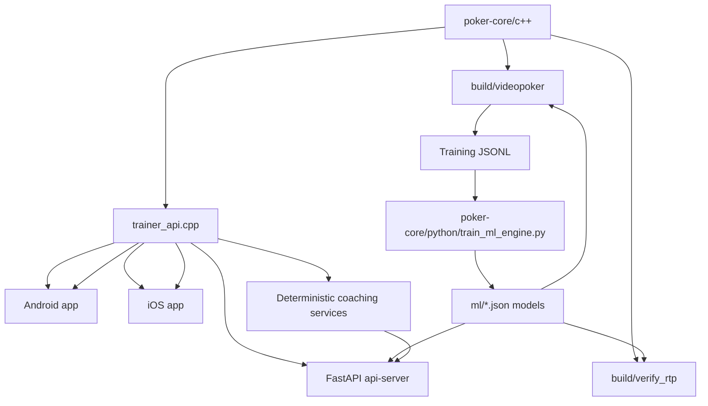

# Equilibrium


Equilibrium is a multi-platform video poker trainer and analysis suite built around a shared C++ core. It currently supports two Jacks or Better paytables, exposes solver, rule, and ML engines in the CLI/core, ships solver-backed mobile trainer apps for Android and iOS, and includes FastAPI interfaces for strategy, evaluation, and deterministic coaching.

## Current Features

- Shared C++17 poker engine used by CLI tools, Android, iOS, and the API
- Two supported game variants:
  - `jacks_or_better_9_6`
  - `jacks_or_better_8_5`
- Three strategy engines in the shared core:
  - `solver`: exhaustive EV search over all 32 hold masks; authoritative for mobile trainer autohold and coaching
  - `rule`: handcrafted strategy table
  - `ml`: experimental local JSON neural-network inference
- RTP verification tool for comparing engines against optimal play
- Training-data export and Python ML trainer
- Android app with Compose + JNI bridge
- iOS app with SwiftUI + Objective-C++ bridge
- FastAPI server backed by the same native trainer API
- Deterministic premium coaching backend with compare, session-summary, and drill-recommendation endpoints

## Supported Variants

| Variant ID | Display Name | Exact optimal RTP at five credits |
| --- | --- | --- |
| `jacks_or_better_9_6` | Jacks or Better 9/6 | `99.543904%` |
| `jacks_or_better_8_5` | Jacks or Better 8/5 | `97.298434%` |

The current paytable difference is the standard 9/6 vs 8/5 change:

- `9/6`: Full House `9x`, Flush `6x`
- `8/5`: Full House `8x`, Flush `5x`

## Architecture



## Repository Layout

- `poker-core/c++`: core engine, solver, rule engine, ML inference, trainer API
- `poker-core/python`: ML training script (`train_ml_engine.py`) plus a legacy Python engine prototype (`autohold.py`, `main.py`, `verify_rtp.py`) that is not used by the C++ core or the mobile apps
- `ml`: trained JSON models such as `modeljob96.json` and `modeljob85.json`
- `api-server`: FastAPI app and Dockerfile
- `android-app`: Android Studio project
- `ios-app`: Xcode project
- `csharp-app`: Windows Forms client for the API
- `resources/cards`: shared card image assets

## Build

Build the CLI binaries from the repo root:

```bash
bash ./build.sh
```

This produces:

- `build/videopoker`
- `build/verify_rtp`
- `build/benchmark_ml` (native scoring worker for the Python EV-regret benchmark)

## CLI

### `videopoker`

Usage:

```bash
./build/videopoker \
  [--engine solver|rule|ml|ml-rerank] \
  [--variant jacks_or_better_9_6|jacks_or_better_8_5] \
  [--ml-model /abs/path/to/model.json] \
  [--print-strategy] \
  [--dump-training training.jsonl] \
  coins bet iterations
```

Notes:

- `solver` is the default engine
- `jacks_or_better_9_6` is the default variant
- `--ml-model` is required for `ml` and `ml-rerank`; their bundle formats are not interchangeable
- `--dump-training` writes JSONL rows using the holds of the selected engine; use `--engine solver` for authoritative training labels

Examples:

```bash
./build/videopoker --variant jacks_or_better_9_6 100 5 10
./build/videopoker --engine rule --variant jacks_or_better_8_5 100 5 10
./build/videopoker --engine ml --variant jacks_or_better_9_6 --ml-model ml/modeljob96.json 100 5 10
./build/videopoker --engine solver --variant jacks_or_better_8_5 --dump-training training85.jsonl 1000000 1 100000
```

### `verify_rtp`

Usage:

```bash
./build/verify_rtp \
  [--engine solver|rule|ml|ml-rerank] \
  [--variant jacks_or_better_9_6|jacks_or_better_8_5] \
  [--ml-model /abs/path/to/model.json] \
  hands_per_run runs [bet=5] [seed=12345]
```

Examples:

```bash
./build/verify_rtp --variant jacks_or_better_9_6 50000 3 5 12345
./build/verify_rtp --engine rule --variant jacks_or_better_8_5 100000 5 5 12345
./build/verify_rtp --engine ml --variant jacks_or_better_9_6 --ml-model ml/modeljob96.json 100000 3 5 12345
```

The tool prints per-run RTP, an overall estimate, a 95% confidence interval, the target RTP for the selected variant, and the delta to target.

### Experimental `ml-rerank` engine

The CLI-only ranker and reranker run natively without Python or PyTorch. Bundles are paytable-specific and support **five credits only**. Use `ml/rerank-job96.json` for 9/6 or `ml/rerank-job85.json` for 8/5.

```bash
./build/videopoker --engine ml-rerank --variant jacks_or_better_9_6 \
  --ml-model ml/rerank-job96.json 100 5 10

./build/verify_rtp --engine ml-rerank --variant jacks_or_better_8_5 \
  --ml-model ml/rerank-job85.json 100000 3 5 12345
```

`verify_rtp` simulates draws, so its sampling error is much larger than the small research gaps below. For exact EV on specific deals, pass five ordered deck IDs per line to `build/benchmark_ml`:

```bash
printf '0 17 21 35 51\n' | ./build/benchmark_ml --engine ml-rerank \
  --variant jacks_or_better_9_6 --ml-model ml/rerank-job96.json
```

The output columns are model mask, solver mask, solver EV, model EV, and initial hand category. The checked-in bundles are fold-0 exports from the [9/6 grouped evaluation](MILESTONES.md#experiment-6-deal-weighted-nested-cross-validation) and the [8/5 replication](MILESTONES.md#experiment-7-conservative-85-reranker-flips). To export a different selected fold, use `poker-core/python/export_rerank_model.py --help`.

## ML Workflow

This workflow trains and benchmarks the JSON models supported by the native `ml` engine. The newer whole-mask ranker and reranker were evaluated separately offline; see [ML research results](#ml-research-results).

Generate solver training data:

```bash
./build/videopoker \
  --engine solver \
  --variant jacks_or_better_9_6 \
  --dump-training training96.jsonl \
  1000000 5 100000
```

Prepare reproducible, leakage-free partitions from explicitly scoped solver data:

```bash
python3 -B poker-core/python/prepare_ml_data.py ml/trainingjob96.jsonl \
  --variant jacks_or_better_9_6 --bet 5 \
  --test-hands 10000 --test-seed 12345 --split-seed 23456 \
  --validation-fraction 0.1 --output-dir build/ml-data-job96
```

This reserves uniform test deals before excluding their equivalents from the
sources, then splits the remaining hand-equivalence groups into train/validation.
Outputs include unchanged labelled rows, replayable test hands and a manifest.
Use a new output directory for each run. Repeat with `trainingjob85.jsonl` and
`jacks_or_better_8_5` for 8/5. See the
[partition contract](docs/ml_architecture.md#6-reproducible-dataset-preparation)
for provenance, membership and reproducibility details.

Train a small candidate on deterministic prefixes of the fixed partitions:

```bash
python3 -B poker-core/python/train_ml_engine.py \
  --manifest build/ml-data-job96/manifest.json \
  --validation-data build/ml-data-job96/validation.jsonl \
  --run-dir build/ml-smoke-job96 --seed 12345 --epochs 2 \
  --max-samples 128 --max-validation-samples 32
```

The run directory contains a model checkpoint per epoch, a final epoch
candidate, and `run.json` with configuration, hashes and training metrics. The
manifest supplies the validation path by default. See
[manifest-driven training](docs/ml_architecture.md#7-manifest-driven-training)
for the full configuration and output contract.

To simulate return for the smoke model:

```bash
./build/verify_rtp \
  --engine ml \
  --variant jacks_or_better_9_6 \
  --ml-model build/ml-smoke-job96/candidate-jacks_or_better_9_6.json \
  100000 3 5 12345
```

The mobile apps currently bundle these earlier variant-specific JSON models, not the offline ranker and reranker:

- `ml/modeljob96.json` for `jacks_or_better_9_6`
- `ml/modeljob85.json` for `jacks_or_better_8_5`

The current mobile trainer UI is solver-backed and does not expose engine switching.

Measure expected return lost against the solver, without sampling replacement draws:

```bash
python3 -B poker-core/python/benchmark_ml.py \
  --ml-model ml/modeljob96.json --variant jacks_or_better_9_6 \
  --bet 5 --hands 100 --seed 12345 --output build/benchmark-job96.json
```

The JSON report includes normalized EV regret, the RTP gap in percentage points,
agreement, worst mistakes, initial-hand categories and replayable ordered hands.
Start with a small pilot: exact solver scoring is more expensive than ML-only
simulation. See [ML architecture](docs/ml_architecture.md#5-solver-backed-ml-ev-regret-benchmark)
for exclusions, replay, baseline results and statistical limitations, and
[verification](docs/verification.md#ml-ev-regret-benchmark) for the focused tests.

## API

The API lives in `api-server/main.py` and loads `api-server/libvideopoker.so` at startup.

Run locally after building the shared library expected by the API, or use the Docker setup:

```bash
bash ./build_docker.sh
```

Default URLs:

- `http://localhost:8001/`
- `http://localhost:8001/docs`
- `http://localhost:8001/openapi.json`

### `POST /v1/video-poker/strategy`

Request:

```json
{
  "variant": "jacks_or_better_9_6",
  "hand": ["KS", "10H", "5H", "10D", "2H"],
  "bet": 5,
  "engine": "solver"
}
```

For `engine: "ml"`, also provide:

```json
{
  "model_path": "/absolute/path/to/model.json"
}
```

Response:

```json
{
  "variant": "jacks_or_better_9_6",
  "hold": ["10H", "10D"],
  "ev": 1.536745,
  "ev_per_coin": 0.307349
}
```

Rules:

- `variant` defaults to `jacks_or_better_9_6`
- `engine` defaults to `solver`
- valid engines are `solver`, `rule`, and `ml`
- valid variants are `jacks_or_better_9_6` and `jacks_or_better_8_5`
- `model_path` is required for ML requests

### `POST /v1/poker/evaluate`

Request:

```json
{
  "hand": ["Ah", "Kh", "Qh", "Jh", "10h"]
}
```

Response:

```json
{
  "hand_name": "Royal Flush",
  "rank_value": 1
}
```

### `POST /v1/coach/compare`

Request:

```json
{
  "variant": "jacks_or_better_9_6",
  "hand": ["Ah", "Kh", "Qh", "Jh", "2c"],
  "bet": 5,
  "top_n": 3
}
```

Response shape includes:

```json
{
  "variant": "jacks_or_better_9_6",
  "best_hold_cards": ["Ah", "Kh", "Qh", "Jh"],
  "best_hold_label": "four_to_royal",
  "best_ev": 18.5,
  "candidates": [
    {
      "rank": 1,
      "hold_cards": ["Ah", "Kh", "Qh", "Jh"],
      "label": "four_to_royal",
      "ev": 18.5,
      "ev_gap_from_best": 0.0,
      "headline": "Four to a royal flush",
      "summary": "Keep the four royal cards because this premium draw has the highest expected value.",
      "pattern_tip": "When you already have four royal cards in one suit, avoid breaking the draw.",
      "explanation": "This is the strongest play because four_to_royal returns the highest expected value in this spot."
    }
  ]
}
```

### `POST /v1/coach/session-summary`

Accepts analyzed hand records and returns deterministic aggregates such as:
- `hands_played`
- `perfect_count`
- `accuracy_rate`
- `total_ev_lost`
- `biggest_mistake`
- `most_common_leak`
- `top_leak_categories`
- `recommended_drill_focus`
- `summary_headline`
- `summary_text`

### `POST /v1/coach/drill-recommendation`

Accepts analyzed hand records and returns a deterministic drill target with:
- `recommended_category`
- `priority`
- `reason`
- `supporting_stats`
- `suggested_focus`
- `secondary_recommendations`

## Mobile Apps

### Android

Open `android-app/` in Android Studio and run the `app` module. The app uses Jetpack Compose and a JNI bridge into the shared C++ trainer API.

Current Android features:

- game dropdown with `Jacks or Better 9/6` and `Jacks or Better 8/5`
- expected RTP label for the selected variant
- variant-aware paytable that updates with the current bet
- autohold toggle
- solver-backed `Deal` / `Draw` trainer flow
- deterministic coaching explanation panel with headline, summary, and optional pattern tip
- solver EV detail rows for best EV, next best hold, and EV edge
- mistake severity feedback for player-selected holds

### iOS

Open `ios-app/VideoPokerTrainer.xcodeproj` in Xcode and run the `VideoPokerTrainer` scheme on a simulator or device. The app uses SwiftUI with an Objective-C++ bridge into the same trainer API.

Current iOS features:

- game picker with `Jacks or Better 9/6` and `Jacks or Better 8/5`
- expected RTP label for the selected variant
- variant-aware paytable that updates with the current bet
- autohold toggle
- solver-backed `Deal` / `Draw` trainer flow
- deterministic coaching explanation panel with headline, summary, and optional pattern tip
- solver EV comparison details
- mistake severity feedback for player-selected holds

## ML Research Results

The best tested standalone recipe scores all 32 holds with a learned whole-mask ranker, then uses one learned reranker to reconsider the top two holds on high-card hands. It makes decisions without calling the solver at inference.

| Paytable | Exact EV solver RTP | Best offline model RTP | Gap to solver |
| --- | ---: | ---: | ---: |
| Jacks or Better 9/6 | 99.543904% | **99.542950%** | 0.000955 pp |
| Jacks or Better 8/5 | 97.298434% | **97.297236%** | 0.001198 pp |

These are expected returns at **five credits**, not simulated payouts. Model results come from five-fold out-of-fold predictions weighted across all 2,598,960 unordered deals; they measure the training recipe, not a deployed checkpoint. Gaps are in percentage points and are calculated before rounding. See [Milestone 3 and final RTP results](MILESTONES.md#final-rtp-results-at-five-credits).

The CLI-only [`ml-rerank` engine](#experimental-ml-rerank-engine) uses exported research checkpoints; it does not replace the native `ml` engine or run in the mobile apps or API. The exact solver remains authoritative for MVP autohold and coaching. The API strategy endpoint still defaults to `solver` and accepts `rule` or `ml` when explicitly requested.

## Windows Desktop App

`csharp-app/` is a Windows Forms client targeting `net8.0-windows`. It is Windows-only in its current form and calls the API rather than embedding the native engine directly.

## Author

Gordon Pusnik

## Licence

Copyright 2026 Gordon Pusnik and contributors.

Licensed under the Apache License, Version 2.0. See [LICENSE](LICENSE).
