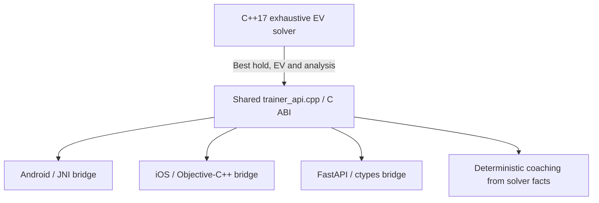
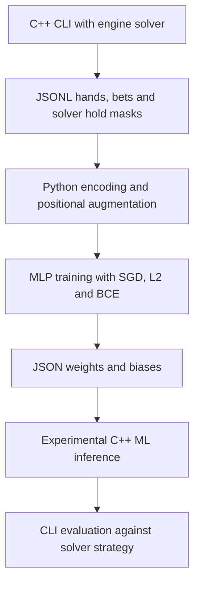
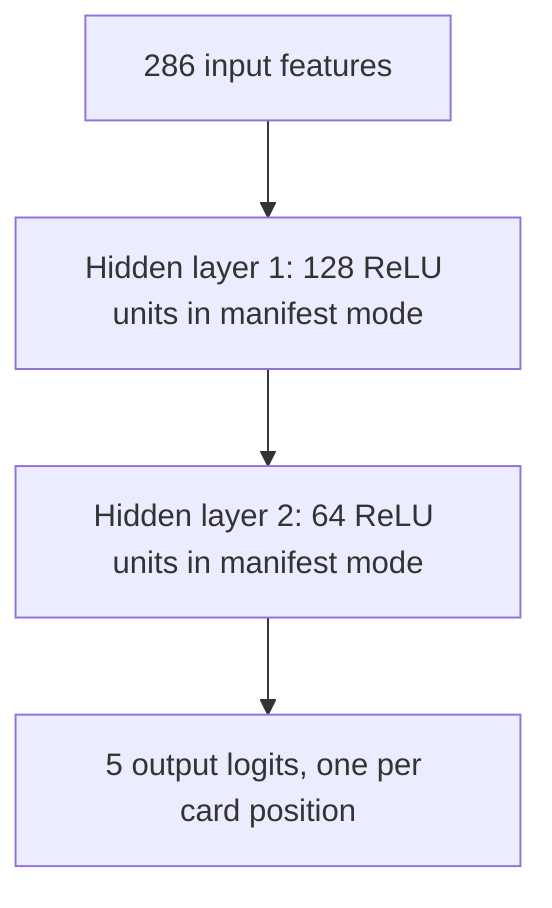

# ML Architecture: Equilibrium Video Poker Trainer

Equilibrium's MVP uses the shared C++17 exhaustive expected-value (EV) solver as the sole authority for autohold and best-play decisions. Deterministic coaching explains solver-backed facts; it cannot select or override a hold. ML training and inference remain experimental and outside the MVP decision path.

The supported MVP variants are `jacks_or_better_9_6` and `jacks_or_better_8_5`.

## 1. Solver-First MVP Architecture

The diagram below shows the intended MVP boundary. The current FastAPI strategy route still exposes additional engines, as described in Section 4; this diagram does not imply that solver-only enforcement is complete across the service.



The solver evaluates all 32 hold masks. Clients consume native hold masks and EV analysis rather than implementing independent strategy. Coaching uses deterministic templates and solver-backed comparisons, including player EV loss, without changing the recommended hold.

## 2. Experimental ML Research Pipeline

Training examples originate in the C++ CLI, not in the Python trainer. The CLI's `--dump-training` option exports the selected engine's holds. Use `--engine solver` explicitly when generating authoritative training labels. Rule- or ML-generated labels are not equivalent to optimal solver labels.



This research path does not feed MVP autohold or coaching. The rule engine is a separate handcrafted strategy available for experimentation and comparison, not an intermediate authority between the solver and the clients.

Relevant implementation files:

- `poker-core/c++/main.cpp`: CLI engine selection and JSONL training export.
- `poker-core/python/train_ml_engine.py`: feature encoding, training and model export.
- `poker-core/c++/autohold.cpp`: solver, rule engine, JSON model loading and ML inference.
- `poker-core/c++/verify_rtp.cpp`: engine return evaluation for a selected variant.

Note: `poker-core/python/autohold.py` is a legacy prototype reachable only through the parallel Python CLI (`poker-core/python/main.py`, `hand.py` and `verify_rtp.py` import it). It is not referenced by the C++ core or by the shipped mobile apps, and it is not part of the active `videopoker-ml-v3` training and native C++ inference pipeline. It encodes only 261 features (five positional 52-card one-hots plus bet) and predicts a single hold mask by taking the argmax of its output layer, so it is incompatible with the current per-card five-logit model. Do not extend it for new work.

## 3. Experimental Neural Network and Training

Manifest training defaults to two hidden layers of 128 and 64 units, matching
the shipped models. The legacy positional CLI defaults to 64 and 32 units.
Both modes accept custom layer sizes. The older `ml/modelv1.json` has a single hidden layer.



### Feature layout

| Features | Count | Encoding |
| --- | --- | --- |
| Ordered cards | 260 | Five positional 52-card one-hot vectors |
| Bet | 1 | Bet divided by 5 |
| Rank counts | 13 | Counts divided by 4 |
| Suit counts | 4 | Counts divided by 5 |
| Sorted ranks | 5 | Ranks divided by 14 |
| Hand summary | 3 | Distinct ranks, maximum suit count and high-card count, each divided by 5 |
| **Total** | **286** | |

There is no variant/paytable input feature. Training data and model evaluation must therefore be scoped to the intended paytable; a model should not be assumed to transfer between 9/6 and 8/5.

### Training behavior

- **Targets:** five hold bits from each JSONL `hold_mask`. Manifest mode requires solver provenance and matching variant and bet on every row. The legacy positional CLI relies on the caller to check provenance.
- **Loss:** binary cross-entropy, using sigmoid probabilities derived from the five logits. These are independent card-hold predictions, not probabilities over all 32 holds or a guarantee of EV-optimal play.
- **Optimizer:** per-sample stochastic gradient descent with manual backpropagation and L2 terms in weight updates.
- **Learning rate:** for one-based epoch `e`, `lr_e = lr_initial × 0.98^(e − 1)`.
- **Augmentation:** `permute_sample` shuffles positional card vectors and their target bits together while preserving invariant hand-statistic features. This encourages position robustness; it does not guarantee permutation invariance.

### Native inference

The current trainer exports `videopoker-ml-v3` JSON with dimensions, weights and biases. C++ loads those values in `autohold.cpp`. For the five-output model, it constructs a hold mask by holding each card whose logit is greater than zero, equivalent to a sigmoid probability greater than 0.5. Native inference does not need to calculate sigmoid values to apply that threshold.

`set_ml_model` accepts two shapes:

- `videopoker-ml-v3`: `input_size`, `hidden1_size`, `hidden2_size`, `output_size`, `W1/b1/W2/b2/W3/b3`. Used by `ml/modeljob96.json`, `ml/modeljob85.json`, `ml/modelv2.json` and `ml/modelv3.json`.
- Legacy single hidden layer: `input_size`, `hidden_size`, `output_size`, `W1/b1/W2/b2`. Used by `ml/modelv1.json` (`videopoker-ml-v2`).

The hold decision is keyed on `output_size`, not on format. When `output_size` is 5, inference uses the per-card rule described below. When it is not 5 — the older 32-output mask-classifier shape — inference instead takes the argmax output index and uses it directly as a 0–31 mask. A five-output model in the legacy single-hidden-layer shape still uses the per-card threshold path. Legacy 261-feature inputs are tolerated: the encoder fills only the positional card vectors and the bet, leaving the hand-summary features at zero.

> **Clarification:** The C++ hold decision uses a hard `logit > 0` threshold rather than computing sigmoid probabilities. This is mathematically equivalent to `sigmoid(logit) > 0.5` because $\sigma(0) = 0.5$ and sigmoid is strictly monotonic; evaluating `logit > 0` in native C++ avoids `std::exp` and division while producing identical hold masks. Furthermore, threshold tuning does not require computing sigmoid: any desired probability threshold $p \in (0, 1)$ translates directly to a constant logit-space threshold $T = \ln(p / (1 - p))$, allowing inference to simply evaluate `logit > T`. Computing sigmoid probabilities explicitly is only required when floating-point confidence scores in $[0, 1]$ are directly needed (e.g., for user-facing UI or coaching explanations, which should also apply temperature scaling if calibrated probabilities are required).

Model accuracy and RTP must be measured for the intended variant before making quality claims.

### Reference measurements

Reproduce the current state with:

```bash
bash ./build.sh
./build/verify_rtp --engine ml --ml-model ml/modeljob96.json --variant jacks_or_better_9_6 200000 3 5 12345
```

Observed: 93.72% RTP (95% CI 92.78–94.67%) against the solver's 99.54% theoretical return, so the current ML engine gives up roughly 5.8 percentage points. Exact-mask agreement with the exported labels, measured on the first 2,000 rows of each source dataset: `modeljob96` 90.4% (97.4% per bit), `modeljob85` 90.2% (97.1% per bit), `modelv3` 94.9% (98.5% per bit). These are in-sample figures against training rows, not held-out validation results.

Dataset provenance is uneven: `ml/trainingjob85.jsonl` and `ml/trainingjob96.jsonl` carry both `engine` and `variant`, while `ml/training1.jsonl` and `ml/training2.jsonl` carry `engine` but no `variant`, so models trained on them cannot be traced to a paytable from the data itself.

## 4. Current Integration and MVP Boundaries

| Layer | Observed implementation | MVP constraint |
| --- | --- | --- |
| Shared C++ core | Supports solver, rule and ML engine selection; exposes solver analysis through `trainer_api.cpp` | Solver alone determines MVP best play and autohold |
| Android | `MainActivity.kt` explicitly selects `solver`; JNI calls the shared trainer API | Preserve solver-only decisions and shared native logic |
| iOS | `ContentView.swift` explicitly selects `solver`; Objective-C++ calls the shared trainer API | Preserve solver-only decisions and shared native logic |
| FastAPI coaching | `api-server/app/native.py` selects `solver` for its solver handles; coaching services derive deterministic output from native facts | Coaching remains secondary and cannot override holds |
| FastAPI strategy | `/v1/video-poker/strategy` defaults to solver but currently accepts `rule` and `ml` | Solver-only MVP service enforcement remains a separate implementation task |
| C# desktop client | `csharp-app/Program.cs` posts to `/v1/video-poker/strategy` with `engine` defaulting to `solver` and an optional `model_path` | Inherits the same strategy-route enforcement gap as FastAPI |

Engine selection is currently global in `autohold.cpp`, even when accessed through trainer handles. A solver handle does not establish per-handle engine isolation. Service enforcement and concurrent engine use require explicit review rather than assuming request-local isolation.

ML artefacts are present in the repository but are not activated in the MVP decision path: `ml/modeljob96.json` and `ml/modeljob85.json` are bundled as Android assets and iOS resources, `api-server/Dockerfile` copies them into the API container, and the Android `nativeSetMlModel` and iOS `loadMlModel` bridge functions are never called by app code. Bundling a model is not the same as using it.

There is no established performance guarantee here for mobile frame rate, inference latency or solver responsiveness. Native integration alone does not prove smooth 60fps gameplay; performance must be measured on target devices.

These are source observations and product constraints, not confirmation that builds, runtime parity or MVP acceptance checks have passed. ML research, new variants and premium expansion do not displace solver correctness or the solver-only MVP boundary.

## 5. Solver-backed ML EV-regret benchmark

The benchmark measures the expected return lost by the existing native ML policy on
initial hands. It does not retrain models or change MVP decisions. The Python driver
handles sampling, exclusions, provenance and JSON output; `build/benchmark_ml` is its
sequential C++ scoring worker. Scoring calls native ML inference followed by
`AutoHold::analyze_player_hold`, so both the best hold and the model-selected hold
are valued by the shared exhaustive solver. No replacement cards are sampled.
Do not use the ML branch's `auto_hold(..., out_ev)` for this measurement: that
branch currently writes zero to `out_ev`.

Build and run a small pilot before increasing the sample size:

```bash
bash ./build.sh
python3 -B -m unittest discover -s poker-core/tests -v
python3 -B poker-core/python/benchmark_ml.py \
  --ml-model ml/modeljob96.json --variant jacks_or_better_9_6 \
  --bet 5 --hands 100 --seed 12345 --output build/benchmark-job96-100.json
```

Use `--hands 1000` for the next baseline, and select `ml/modeljob85.json` with
`--variant jacks_or_better_8_5` to measure the other shipped model. The driver
requires an explicit variant: models do not carry verified paytable provenance.
It accepts the exported nested-array models with 261 or 286 inputs and 5 or 32
outputs, validating dimensions and finite float32-compatible weights before scoring.

For each hand, normalized regret is:

```text
(solver_best_ev - model_hold_ev) / bet
```

EVs are expected returned coins, including the stake in paying outcomes, rather
than net profit. `100 * mean_normalized_regret` is the expected RTP gap in
**percentage points** for the evaluated hand distribution. The report also includes:

- exact-mask agreement and EV-optimal agreement, the latter accepting a normalized
  regret of at most `1e-9` so equally valuable alternative holds are not mistakes;
- the mean regret's sample standard error and an approximate normal 95% interval
  (`null` for a single hand), without clipping the interval at zero;
- mean solver and model expected returns on the same sampled initial hands;
- native initial-hand categories, with frequencies, mean regrets and contributions
  to total regret, plus the worst 20 mistakes exceeding the tolerance;
- every ordered initial hand, both masks and EVs, variant, bet, seed, model SHA-256,
  driver and shared-helper SHA-256, native binary SHA-256, benchmark version and scoring time.

Sampling is uniform over ordered five-card deals, with replacement between hands.
The interval describes sampling uncertainty over initial-hand regrets, not draw
outcomes. Small samples can miss rare severe mistakes; even an all-zero sample does
not establish zero population loss. The sampled solver mean is not the theoretical
full-deck RTP, and the report does not subtract regret from a theoretical constant
or claim that a small run establishes near-solver performance.

### Training exclusions and replay

Exclude known training hands with repeatable `--exclude-training` arguments:

```bash
python3 -B poker-core/python/benchmark_ml.py \
  --ml-model ml/modeljob96.json --variant jacks_or_better_9_6 \
  --bet 5 --hands 1000 --seed 12345 \
  --exclude-training ml/trainingjob96.jsonl \
  --output build/benchmark-job96-excluded.json
```

Exclusions read the `initial` cards from each JSONL row and reject equivalent hands
under both card reordering and any global suit renaming. They apply regardless of
the training row's bet or variant. Accepted hands remain uniform **conditional on
not belonging to excluded classes**; their mean regret is not an unconditional
full-deck RTP gap. The report records exclusion file hashes, row counts, unique
excluded classes and the number of rejected proposals. Provenance remains
unverified beyond the supplied files: exclusions alone do not prove a complete
held-out evaluation for a model with unknown training history.

Replay a prior report's exact ordered hands when comparing models:

```bash
python3 -B poker-core/python/benchmark_ml.py \
  --ml-model ml/modeljob96.json --variant jacks_or_better_9_6 \
  --bet 5 --input build/benchmark-job96-100.json \
  --output build/benchmark-job96-replay.json
```

`--input` and `--hands` are mutually exclusive. Replay requires the same variant and
bet, rejects hands matching any explicitly supplied exclusions, and records the
source report's hash. It does not inherit training exclusions or establish that
the supplied hands were randomly sampled. The stored hands, rather than the seed
alone, are the durable basis for comparisons across Python versions. Timing and
provenance fields can differ between runs; scores and summaries for identical
hands, model, variant and bet should reproduce.

### Initial baseline: 2026-11-12

Both shipped paytable models were evaluated at bet 5 on the **same 1,000 uniformly
sampled ordered hands**, seed `12345`, with no training exclusions. These are
population-sampling diagnostics with possible training overlap, not verified
held-out results. The 100-hand 9/6 pilot took approximately 3.8 seconds; each
1,000-hand baseline took approximately 38 seconds on the review machine.

| Model | Mean EV gap (percentage points) | Approximate 95% interval for gap | EV-optimal agreement |
| --- | ---: | ---: | ---: |
| `modeljob96` | 5.2018 | 3.7833–6.6204 | 90.7% |
| `modeljob85` | 3.6065 | 2.5641–4.6488 | 90.4% |

Exact-mask agreement equalled EV-optimal agreement in these two samples. Initial
high-card hands accounted for 3.9523 and 2.7000 percentage points of the respective
total gaps. These broad categories do not identify individual missed draw patterns.
The worst sampled mistake for both models was holding all of `5h 7h 6h 5s 3h`,
which pays zero, instead of the solver's four-heart hold (`mask 23`, discarding
`5s`). Its normalized EV loss was 2.3404 for 9/6 and 2.1702 for 8/5.

Model SHA-256 fingerprints for these measurements:

- `modeljob96`: `08887de13c2429825d8455b5258f27a3cb13fbcc5edec416d2c63d3ffaf9ffe3`
- `modeljob85`: `075ceebb028c8afcfdaa76c4bcfdc89b0d148929f6caa00b675ae94c22bce789`

Reproduce the baseline with the pilot command above using `--hands 1000` and the
matching model/variant. Reports were written to `build/benchmark-job96-1000.json`
and `build/benchmark-job85-1000.json`; generated reports under `build/` are ignored
by Git. Each contains the complete ordered hands for replay. Native binary hashes
can differ after rebuilding with another compiler or platform.

A separate 100-hand smoke run successfully loaded all 100,000 rows from
`ml/trainingjob96.jsonl`, excluded their equivalent hand classes and scored the
remaining sample. That smoke run validates the exclusion path; it is not a
held-out performance conclusion. Larger representative samples and verified
training provenance remain necessary before evaluating a near-solver target.

## 6. Reproducible dataset preparation

`poker-core/python/ml_data.py` owns card validation, the hand-equivalence key,
file hashing and uniform sampling shared by the benchmark and
`poker-core/python/prepare_ml_data.py`. Prepare 9/6 first:

```bash
python3 -B poker-core/python/prepare_ml_data.py ml/trainingjob96.jsonl \
  --variant jacks_or_better_9_6 --bet 5 \
  --test-hands 10000 --test-seed 12345 --split-seed 23456 \
  --validation-fraction 0.1 --output-dir build/ml-data-job96
```

For 8/5 use `ml/trainingjob85.jsonl`, `--variant jacks_or_better_8_5` and a new
output directory. Multiple positional JSONL sources are supported. Every
nonblank row in every source must be an object with explicit `engine: solver`,
the requested `variant`, an integer matching `bet` (1–5), five distinct valid
`initial` cards, and an integer `hold_mask` (0–31). Booleans and coerced strings
are rejected for integer fields. Optional `final` cards and nonnegative integer
`payout` fields are also checked. Malformed rows fail with the source path and
physical line number, even when they would later be excluded. Files missing
provenance, including `training1.jsonl` and `training2.jsonl`, are rejected.
This validates declared solver provenance; it does not recompute label optimality.

Preparation proceeds in this fixed order:

1. Sample the final test cohort uniformly over ordered five-card deals, with
   replacement between hands and no source-dependent exclusions. Repeated hands
   and repeated equivalence classes are retained to preserve that distribution.
2. Validate all sources and remove every row equivalent to any test hand.
3. Sort the remaining unique equivalence keys, shuffle them using the independent
   split seed, and assign a prefix to validation. Its group count is the floor of
   `validation_fraction * remaining_groups`, clamped to keep both splits nonempty.
   At least two non-test groups are required. All other groups go to training.

Keys are sorted four-suit rank-bitsets, invariant under card order and any global
suit renaming. Group assignment never rewrites cards or masks. Duplicate rows
and distinct ordered examples from the same group stay together; source order
is retained within each output. The validation fraction applies to **groups**,
so its row fraction can differ when groups have unequal numbers of examples.

The new output directory contains:

- `train.jsonl` and `validation.jsonl`: original source rows byte-for-byte, with
  a terminating newline added if absent. Blank source lines are omitted.
- `test.json`: ordered, unlabelled test hands with variant and bet, compatible
  with benchmark `--input`. Labels and EVs come from native solver scoring at
  final evaluation; test-equivalent source labels are excluded from both splits.
- `manifest.json`: version, variant/bet, both seeds, sampling/splitting algorithms,
  Python version, preparation/helper code hashes, ordered absolute source paths,
  source-byte hashes and row counts. Each partition records its relative path,
  SHA-256, row count, group count and sorted group keys. Train and validation
  membership lists map each output row to a zero-based source index and one-based
  physical source line. Removed test-equivalent source rows have the same membership
  and count records under `excluded_test_equivalent`. Ordered test membership is
  stored in `test.json`, bound to the manifest by its hash.

Existing output directories are rejected to protect fixed experiments. Identical
source bytes, source order, configuration and code in the same Python runtime
produce byte-identical artifacts, including the manifest, in a new directory.
The stored hands and membership are durable across runtimes; do not rely on seeds
alone for reproducing a cohort after changing Python versions. Generated artifacts
under `build/` are ignored by Git; retain the complete directory for an experiment.
The test reservation guarantees disjointness for newly prepared training and
validation data. It makes no held-out claim about a shipped model's training history.

Run the preparation tests without a native build:

```bash
python3 -B -m unittest discover -s poker-core/tests -p 'test_prepare_ml_data.py' -v
```

The full suite after `bash ./build.sh` also checks the shared key against all
120 card orders and 24 suit renamings of a repeated-rank hand and verifies native
benchmark behavior.

## 7. Manifest-driven training

Start with a short seeded run on the 9/6 partitions:

```bash
python3 -B poker-core/python/train_ml_engine.py \
  --manifest build/ml-data-job96/manifest.json \
  --validation-data build/ml-data-job96/validation.jsonl \
  --run-dir build/ml-smoke-job96 --seed 12345 --epochs 2 \
  --max-samples 128 --max-validation-samples 32
```

Both labelled partition paths default to the locations in the manifest.
`--validation-data` can point to a copy of the fixed validation file. The
trainer verifies both complete files against the manifest SHA-256 hashes, row
counts and group keys, and checks disjointness using the recorded test keys.
The ordered test cohort can be stored separately since fitting reads only the
labelled partitions. Source hashes are carried over from preparation.

The trainer uses the supplied validation rows for epoch metrics and shuffles
the training rows each epoch for SGD. It rejects `--validation-split` in this
mode. The sample limits select ordered prefixes for small runs. Omit them to
train and validate on the complete fixed partitions. The defaults are 286
inputs, 128 and 64 hidden units, five output logits, 20 epochs, a learning rate
of 0.01, L2 of `1e-6` and seed 12345. The optimizer, loss, learning rate decay
and augmentation are described in section 3.

Each new run directory contains these files:

- `checkpoints/epoch-NNN.json` holds the native inference model at that epoch.
- `candidate-jacks_or_better_9_6.json` is a separate copy of the final epoch
  checkpoint. Keep the epoch files for later candidate selection by validation
  EV regret. For 8/5, the candidate filename uses that variant ID.
- `run.json` records runtime and trainer/helper code hashes, the manifest and
  dataset hashes, rows available and used, effective configuration and seed,
  metrics for each completed epoch, and model hashes. Loss is the mean per-hand
  sum of five binary cross-entropy terms. Exact mask and bit agreement are
  classification diagnostics.

The record is updated after each saved checkpoint. The completed record identifies
the final candidate. For identical inputs and configuration in the same runtime,
reruns in separate output directories reproduce the metrics and model bytes.
The original positional CLI, `train_ml_engine.py input.jsonl output.json`, is
available for experiments that use its internal row split.
