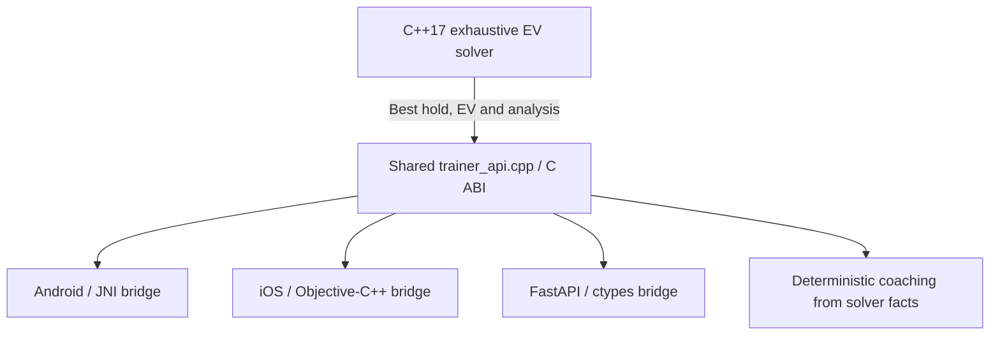
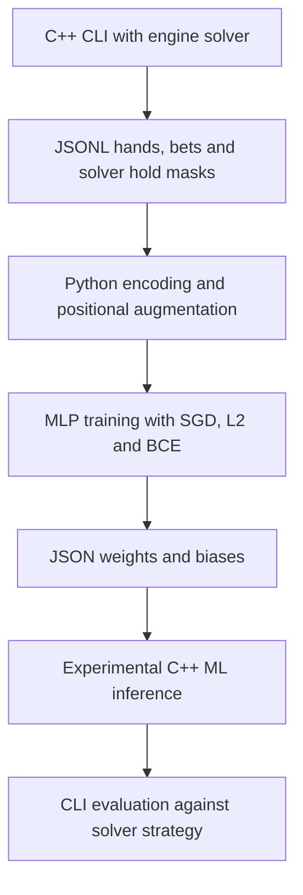
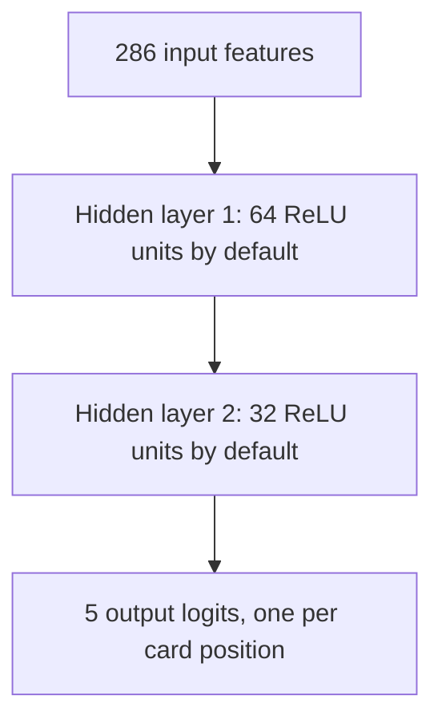

# ML Architecture: Equilibrium Video Poker Trainer

Equilibrium's MVP uses the shared C++17 exhaustive expected-value (EV) solver as the sole authority for autohold and best-play decisions. Deterministic coaching explains solver-backed facts; it cannot select or override a hold. ML training and inference remain experimental and outside the MVP decision path.

The supported MVP variants are `jacks_or_better_9_6` and `jacks_or_better_8_5`.

## 1. Solver-First MVP Architecture

The diagram below shows the intended MVP boundary. The current FastAPI strategy route still exposes additional engines, as described in Section 4; this diagram does not imply that solver-only enforcement is complete across the service.

The solver evaluates all 32 hold masks. Clients consume native hold masks and EV analysis rather than implementing independent strategy. Coaching uses deterministic templates and solver-backed comparisons, including player EV loss, without changing the recommended hold.

## 2. Experimental ML Research Pipeline

Training examples originate in the C++ CLI, not in the Python trainer. The CLI's `--dump-training` option exports the selected engine's holds. Use `--engine solver` explicitly when generating authoritative training labels. Rule- or ML-generated labels are not equivalent to optimal solver labels.

This research path does not feed MVP autohold or coaching. The rule engine is a separate handcrafted strategy available for experimentation and comparison, not an intermediate authority between the solver and the clients.

Relevant implementation files:

- `poker-core/c++/main.cpp`: CLI engine selection and JSONL training export.
- `poker-core/python/train_ml_engine.py`: feature encoding, training and model export.
- `poker-core/c++/autohold.cpp`: solver, rule engine, JSON model loading and ML inference.
- `poker-core/c++/verify_rtp.cpp`: engine return evaluation for a selected variant.

Note: `poker-core/python/autohold.py` is an unreferenced legacy prototype (using an older 261-feature / 32-output model format) and is not part of the active `videopoker-ml-v3` training and native C++ inference pipeline.

## 3. Experimental Neural Network and Training

The Python trainer defaults to two hidden layers of 64 and 32 units. Hidden-layer sizes are configurable; they are not fixed requirements for every exported model. The native loader also supports legacy models with one hidden layer.

### Feature layout

| Features | Count | Encoding |
| --- | --- | --- |
| Ordered cards | 260 | Five positional 52-card one-hot vectors |
| Bet | 1 | Bet divided by 5 |
| Rank counts | 13 | Counts divided by 4 |
| Suit counts | 4 | Counts divided by 5 |
| Sorted ranks | 5 | Ranks divided by 14 |
| Hand summary | 3 | Distinct ranks, maximum suit count and high-card count, each divided by 5 |
| **Total** | **286** | |

There is no variant/paytable input feature. Training data and model evaluation must therefore be scoped to the intended paytable; a model should not be assumed to transfer between 9/6 and 8/5.

### Training behavior

- **Targets:** five hold bits from each JSONL `hold_mask`. The loader does not enforce that labels came from the solver or filter rows by variant; dataset provenance must be checked separately.
- **Loss:** binary cross-entropy, using sigmoid probabilities derived from the five logits. These are independent card-hold predictions, not probabilities over all 32 holds or a guarantee of EV-optimal play.
- **Optimizer:** per-sample stochastic gradient descent with manual backpropagation and L2 terms in weight updates.
- **Learning rate:** for one-based epoch `e`, `lr_e = lr_initial × 0.98^(e − 1)`.
- **Augmentation:** `permute_sample` shuffles positional card vectors and their target bits together while preserving invariant hand-statistic features. This encourages position robustness; it does not guarantee permutation invariance.

### Native inference

The current trainer exports `videopoker-ml-v3` JSON with dimensions, weights and biases. C++ loads those values in `autohold.cpp`. For the five-output model, it constructs a hold mask by holding each card whose logit is greater than zero, equivalent to a sigmoid probability greater than 0.5. Native inference does not need to calculate sigmoid values to apply that threshold.

> **Clarification:** The C++ hold decision uses a hard `logit > 0` threshold rather than computing sigmoid probabilities. This is mathematically equivalent to `sigmoid(logit) > 0.5` because $\sigma(0) = 0.5$ and sigmoid is strictly monotonic; evaluating `logit > 0` in native C++ avoids `std::exp` and division while producing identical hold masks. Furthermore, threshold tuning does not require computing sigmoid: any desired probability threshold $p \in (0, 1)$ translates directly to a constant logit-space threshold $T = \ln(p / (1 - p))$, allowing inference to simply evaluate `logit > T`. Computing sigmoid probabilities explicitly is only required when floating-point confidence scores in $[0, 1]$ are directly needed (e.g., for user-facing UI or coaching explanations, which should also apply temperature scaling if calibrated probabilities are required).

Model accuracy and RTP must be measured for the intended variant before making quality claims.

## 4. Current Integration and MVP Boundaries

| Layer | Observed implementation | MVP constraint |
| --- | --- | --- |
| Shared C++ core | Supports solver, rule and ML engine selection; exposes solver analysis through `trainer_api.cpp` | Solver alone determines MVP best play and autohold |
| Android | `MainActivity.kt` explicitly selects `solver`; JNI calls the shared trainer API | Preserve solver-only decisions and shared native logic |
| iOS | `ContentView.swift` explicitly selects `solver`; Objective-C++ calls the shared trainer API | Preserve solver-only decisions and shared native logic |
| FastAPI coaching | `api-server/app/native.py` selects `solver` for its solver handles; coaching services derive deterministic output from native facts | Coaching remains secondary and cannot override holds |
| FastAPI strategy | `/v1/video-poker/strategy` defaults to solver but currently accepts `rule` and `ml` | Solver-only MVP service enforcement remains a separate implementation task |

Engine selection is currently global in `autohold.cpp`, even when accessed through trainer handles. A solver handle does not establish per-handle engine isolation. Service enforcement and concurrent engine use require explicit review rather than assuming request-local isolation.

There is no established performance guarantee here for mobile frame rate, inference latency or solver responsiveness. Native integration alone does not prove smooth 60fps gameplay; performance must be measured on target devices.

These are source observations and product constraints, not confirmation that builds, runtime parity or MVP acceptance checks have passed. ML research, new variants and premium expansion do not displace solver correctness or the solver-only MVP boundary.
